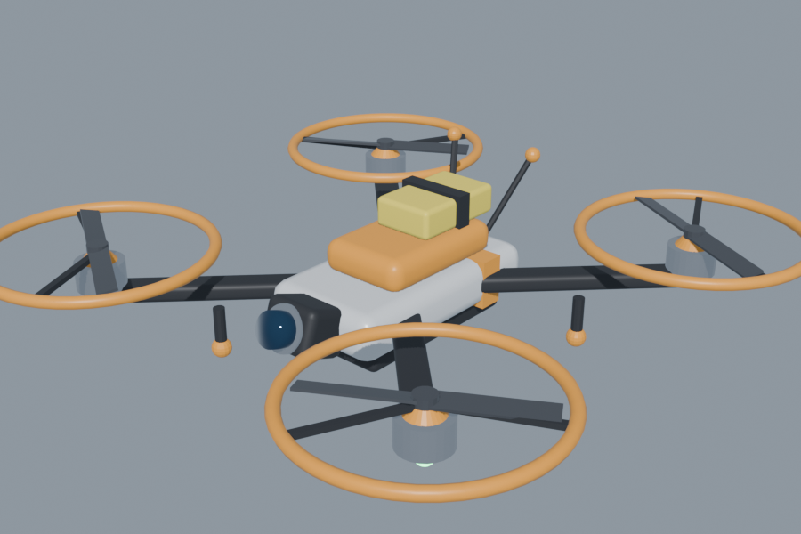

# Drone FPV: a flyable camera drone for The Planet Crafter

Launch a small quadcopter from your hand and fly it in first person (or a chase cam) with its own drone HUD.
Your astronaut stays where you left them, still breathing, so keep an eye on the pilot vitals.

## Controls

| Action | Keyboard | Controller |
|---|---|---|
| Launch drone / back to body / re-enter drone | **V** | **L3 + R3** (both sticks pressed) |
| Move forward / back / strafe | **W S A D** | left stick |
| Up / down | **↑ / ↓** or **Space / Left Ctrl** | **RT / LT** (or RB / LB) |
| Turn | **← / →** or mouse | right stick X |
| Camera tilt | **PgUp / PgDn** or mouse Y | right stick Y |
| Boost | **Left Shift** | **A** |
| Speed mode (CINE / NORMAL / SPORT) | **N** | D-pad → / ← |
| FPV / chase camera | **B** | D-pad ↑ |
| Recall drone | **X** | D-pad ↓ |
| Show / hide help | **H** | |

All keys, range, battery time, mouse sensitivity and FOV can be changed in
`BepInEx/config/guy.planetcrafter.dronefpv.cfg` (created after the first launch).

## The drone HUD
While flying, the game's HUD and hand are hidden and the drone's OSD takes over:
- a heading tape and compass;
- an artificial horizon that rolls with the drone;
- speed and vertical speed;
- altitude above ground and relative to you;
- battery, link signal with static as you near max range (400 m), and a home arrow with distance;
- a REC timer, coordinates and the speed and camera modes;
- your astronaut's O₂ / HP / H₂O;
- warnings: low battery, weak signal, obstacle ahead, pilot vitals critical.

The battery drains as you fly, faster with boost, and recharges while the drone is recalled.
When you press V to go back to your body, the drone keeps hovering where you left it. Press V again to take it back, or X to pack it away.

## Install
1. Install BepInEx 5 (x64, Mono) in the game folder.
2. Copy `DroneFPV.dll`, `drone.obj` and `drone.mtl` to `BepInEx/plugins/DroneFPV/`.

Or run `./build.sh`, which compiles the plugin and installs it into the Steam copy.

## Remove
Delete `BepInEx/plugins/DroneFPV`. To remove BepInEx too, delete `winhttp.dll`, `doorstop_config.ini`,
`changelog.txt` and `BepInEx/` from the game folder.

## Rebuilding the model
`tools/blender_build_drone.py` builds the drone in its own Blender scene ("DroneFPV") and the export step writes
`assets/drone.obj`. Objects named `prop*` spin in game; materials named `LED*` glow and blink.

Built with Claude Code (AI-assisted). Uses BepInEx. No game files are included.
